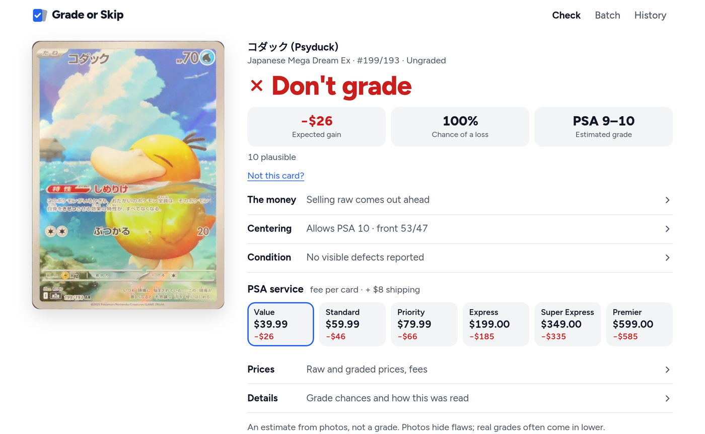

# Grade or Skip

**Should you pay to grade this Pokémon card?** Scan the front and back of a raw card and get a straight answer in dollars: grade it, skip it, or it's marginal, with the math shown.

Free to self-host. Bring your own AI key, or run it without one.
Don't want to self-host? Try it at [gradeorskip.com](https://gradeorskip.com). The first scan needs no sign-in.



A real scan: 53/47 centering, no visible defects and a likely PSA 9–10, and grading it still loses about $26.

## What you get

- **Measured centering.** Computer vision finds the card, corrects perspective and measures the borders. An overlay shows what it measured, and a read it can't trust says "not measured" instead of guessing.
- **A condition read.** A vision model reports corners, edges and surface, and marks where it saw issues.
- **A grade range,** such as PSA 8–9. Never one confident number.
- **The money answer.** Expected value of grading versus selling raw, using PSA's tiers, fees and shipping, with every step of the math shown.
- **A guided phone camera,** batch checks for up to 20 cards, and a local history.

## How far to trust it

This is an estimate from photos, not a grade.

- **No check has been compared with real PSA results yet,** so there is no accuracy figure, and the grade chances are hand-set estimates.
- **The condition read misses subtle damage.** In testing it found 3 of 9 labelled defects, missing bends, dents, faint whitening and print lines. See `docs/condition_eval.md`.
- **Centering thresholds were tuned on about 20 images,** and near-borderless cards can't be measured. See `docs/centering.md`.
- **PSA's fees change.** They live in `config/psa_fees.json`, checked against PSA's announcements on 2026-10-31. Check them before you submit, and send a pull request when they move.

## Run it

With Docker:

```bash
git clone https://github.com/0x4rch/gradeorskip
cd gradeorskip
cp .env.example .env     # add a key if you have one
docker compose up -d
```

Then open http://localhost:8790.

Without Docker (Python 3.11+):

```bash
./dev.sh                 # creates .venv and serves on 127.0.0.1:8790
make test
```

### Using your phone

The live guided camera needs HTTPS, because browsers block camera access on plain `http://` from another device. On plain HTTP the app still works: it opens your phone's own camera app and checks each photo afterwards. For the guided camera, either:

- run `./share.sh`, which opens a temporary Cloudflare tunnel and prints a link and QR code (needs `cloudflared` and `GRADEORSKIP_ACCESS_KEY`), or
- put it behind your own HTTPS reverse proxy. Caddy's `tls internal` works on a home network, once each phone trusts Caddy's root certificate.

Details are in `docs/capture.md`.

### Keep it private

There are no accounts or usage limits. **Don't put it on the open internet without your own login in front of it:** anyone who can reach it can spend your AI credit. `GRADEORSKIP_ACCESS_KEY` only protects traffic that arrives through a Cloudflare tunnel.

## Configuration

Set these in `.env`. All are optional.

| Variable | What it does |
|---|---|
| `ANTHROPIC_API_KEY` | Condition read and card identification through Claude. Default model `claude-sonnet-5-5`; override with `ANTHROPIC_MODEL`. |
| `OPENAI_API_KEY` | The same through OpenAI. Default model `gpt-5.5`, about $0.03 per check; override with `OPENAI_MODEL`. |
| `GRADEORSKIP_LLM_PROVIDER` | `auto` (default), `anthropic`, `openai`, `mock` (fake demo data, clearly labelled) or `none`. |
| `PRICECHARTING_API_KEY` | Auto-filled graded prices. Needs a paid PriceCharting subscription. |
| `POKEMONTCG_API_KEY` | Higher pokemontcg.io rate limits. |
| `GRADEORSKIP_BRAND` | The name shown in the app. |
| `GRADEORSKIP_DATA_DIR` | Where history and photos live. Default `./data`, or `/data` in Docker. |
| `GRADEORSKIP_ACCESS_KEY` | Gates Cloudflare tunnel traffic. |
| `GRADEORSKIP_SOURCE_URL` | The source link in the footer. Point it at your copy if you run a modified version for others. |
| `GRADEORSKIP_SCRAPE_PRICECHARTING` | Set to `1` to read PriceCharting's public pages. See below. |
| `GRADEORSKIP_TAG` | Set to `1` to add TAG alongside PSA. Off because sold data only reached TAG 10 in testing, so most checks stop at "Need prices". |

With no AI key you still get centering, a wider grade range and the ROI math.

### Prices

Raw prices come from free card APIs (pokemontcg.io, with TCGdex as a fallback). Graded prices have three sources:

1. **Type them in.** Sold-search links are on the page. This is the default, and the app never invents a price.
2. **A PriceCharting API key.** The provider is written but hasn't been tested against the live API yet, so reports are welcome.
3. **`GRADEORSKIP_SCRAPE_PRICECHARTING=1`** reads PriceCharting's public card pages. It's off by default: check their terms first, keep your usage personal and light, and expect it to break if their pages change.

## How it's built

FastAPI, Jinja templates, vanilla JS and SQLite, with OpenCV for centering. There's no build step.

```
gradeorskip/
  centering.py    card detection, perspective warp, border measurement, overlay
  grading.py      centering tables, condition ceilings, grade-range model (hand-set priors)
  roi.py          expected-value math and verdict
  pipeline.py     one check: photos -> centering -> vision model -> grade estimate
  providers/      vision models (Anthropic, OpenAI, mock) and price sources
  app.py          routes; templates/ and static/ hold the UI
config/           PSA and TAG fee tables with sources and dates
scripts/          fixtures, calibration and evaluation tools
docs/             how centering, capture and condition evaluation work
```

## Calibration

The biggest open job is measuring accuracy against real results. Photograph cards before they go to PSA, record the grade that comes back, and run:

```bash
# DIR/labels.csv: front,back,grade   (paths relative to DIR)
.venv/bin/python scripts/calibrate.py DIR --max-cost 2.00 --out results.csv
.venv/bin/python scripts/calibrate.py DIR --no-llm      # free, centering only
```

## License

[AGPL-3.0](LICENSE). You can use, change and self-host this freely. If you run a modified version for other people, you have to offer them your source.

The Grade or Skip name and logo aren't covered by the license, so please use your own if you publish a fork.

Fonts: Figtree, under the SIL Open Font License.

Grade or Skip is an independent project. It isn't affiliated with or endorsed by PSA, TAG, CGC, BGS or any grading company, or by Nintendo, Creatures, Game Freak or The Pokémon Company. Pokémon and card names are trademarks of their respective owners.
